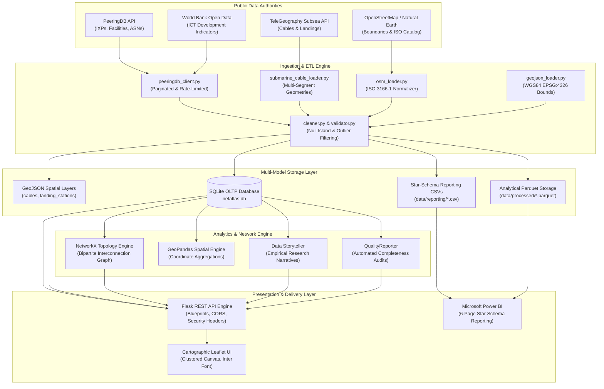

# NetAtlas Architecture & System Design Specification

## 1. System Overview

**NETATLAS** is an independently engineered global internet infrastructure intelligence and geospatial analytics platform. The system ingests, normalizes, spatializes, and visualizes the planetary physical and logical networks supporting international internet connectivity.

---

## 2. Component Subsystems

### A. Ingestion Engine (`backend/ingestion/`)
- **PeeringDB Client:** Executes paginated HTTP requests (`limit`, `skip`) with exponential backoff to respect community API thresholds. Serializes raw payloads to `data/raw/` for air-gapped reproducibility.
- **Submarine Cable Loader:** Ingests official TeleGeography MultiLineString route vectors and coastal landing stations. Implements topology-preserving MultiLineString merging for multi-segment transoceanic cables.
- **GeoJSON Loader:** Enforces EPSG:4326 WGS84 coordinate boundaries (`[-180, 180]`, `[-90, 90]`) and prunes corrupt (0,0) Null Island coordinates.

### B. Preprocessing & Quality Assurance (`backend/preprocessing/`)
- **DataCleaner:** Standardizes null representations, trims whitespace, and normalizes ISO 3166-1 country codes.
- **DataValidator:** Checks bounds, anomaly thresholds (lengths > 50,000 km or RFS years outside 1950–2035), and referential integrity between networks and exchange points.
- **QualityReporter:** Generates automated JSON and Markdown data health audits calculating attribute completeness ratios.

### C. Network Topology Engine (`backend/network_analysis/`)
- **Bipartite Peering Graph:** Constructs a graph $G = (V_{net} \cup V_{ix}, E)$ modeling observed presence on IXP switching fabrics.
- **Graph Metrics:** Computes connected components, giant component dominance ratio, and empirical degree distributions.

### D. REST API Engine (`backend/api/`)
- Built on Flask with modular blueprints.
- Strictly adheres to security standards: Content-Security-Policy, X-Content-Type-Options: nosniff, X-Frame-Options: SAMEORIGIN, parameterized ORM queries, and CORS origin restrictions.

### E. Frontend GIS Experience (`frontend/public/`)
- Central interactive Leaflet canvas utilizing standard OpenStreetMap cartographic tiles.
- Vector rendering of subsea cables with interactive hover inspection.
- Marker clustering for thousands of worldwide colocation facilities.
- Multi-category instant search with client-side debounce.
- Plotly-powered analytical charts.

