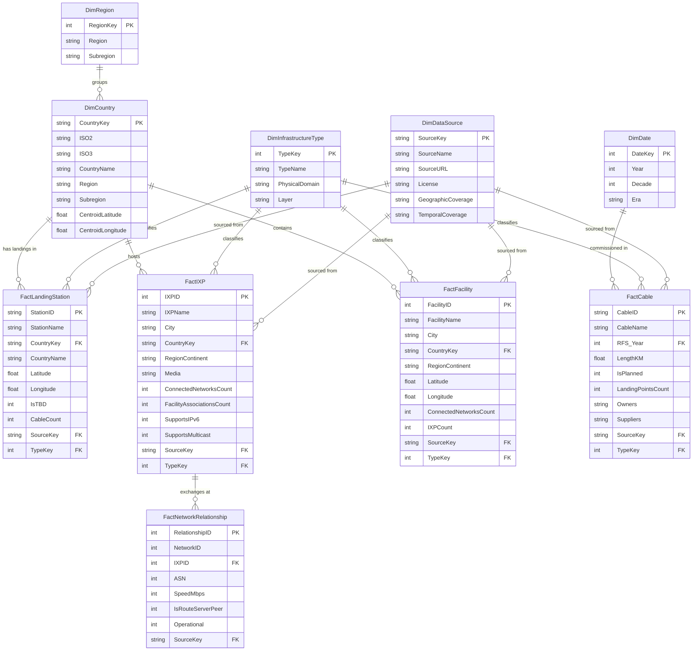

# NetAtlas Power BI Star-Schema Reporting Architecture

## 1. Dimensional Model Overview

The NetAtlas analytical reporting engine follows the Kimball dimensional modeling methodology. The data model is optimized for high-performance Power BI exploratory slicing, geospatial filtering, and DAX metric evaluation.

---

## 2. Power BI Reporting Pages Architecture

### Page 1: Global Infrastructure Overview
- **Header KPIs:** Total Subsea Cables, Total Cable Landing Stations, Total Internet Exchanges, Total Colocation Facilities, Total Peering Interconnections.
- **Geographic Map:** Bubble map of landing stations and facilities sized by cable/network count.
- **Infrastructure by Layer Donut:** Proportion of physical subsea, landing, switching, and colocation assets.
- **Data Freshness & Provenance Card:** Data extraction timestamps and source authority acknowledgments.

### Page 2: Submarine Cable Intelligence
- **Commissioning Trend (Line/Column):** Distribution of cables by Ready-for-Service (RFS) year across decades.
- **Top Cable Consortia (Bar):** Leading infrastructure owners (Meta, Google, SubCom, Orange, Telxius).
- **Cable Length Distribution (Histogram):** Distribution from regional island links (<500 km) to transoceanic trunk lines (>15,000 km).
- **Operational vs. Planned Ratio (Gauge):** Percentage of active subsea lines versus announced future systems.

### Page 3: Internet Exchange Analytics
- **Top 15 Global IXPs by Connected ASNs (Horizontal Bar):** DE-CIX, LINX, AMS-IX, IX.br, Equinix.
- **IXP Distribution by Country (Choropleth/Tree Map):** Sovereign concentration of peering points.
- **Protocol Adoption:** Ratio of IPv6-enabled and multicast-capable exchange points.

### Page 4: Data Centre and Facility Analytics
- **Colocation Density by Macro-Region (Bar):** Comparing North America, Western Europe, Asia-Pacific, Latin America, and Africa.
- **Top Global Colocation Hubs (City Breakdown):** Ashburn, London, Frankfurt, Tokyo, Singapore.
- **Network Attachment Depth (Scatter):** Facilities plotted by Connected ASNs vs. Present IXPs.

### Page 5: Global Network Connectivity
- **Bipartite Interconnection Network Summary:** Total observed edges, network participation rates.
- **Port Speed Distribution:** 10G, 40G, 100G, and 400G port capacity breakdown.
- **Route Server Adoption:** Route server vs. bilateral peering proportions.

### Page 6: Data Quality and Methodology
- **Attribute Completeness Gauges:** Coordinate accuracy (100% for landings, 90%+ for facilities), RFS year completeness, length completeness.
- **Source Authority & Licensing Matrix:** CC BY-SA 4.0, CC BY 4.0, ODbL attribution table.
- **Methodological Limitations Callout:** Formal disclaimer regarding voluntary registration dynamics in community infrastructure registries.

